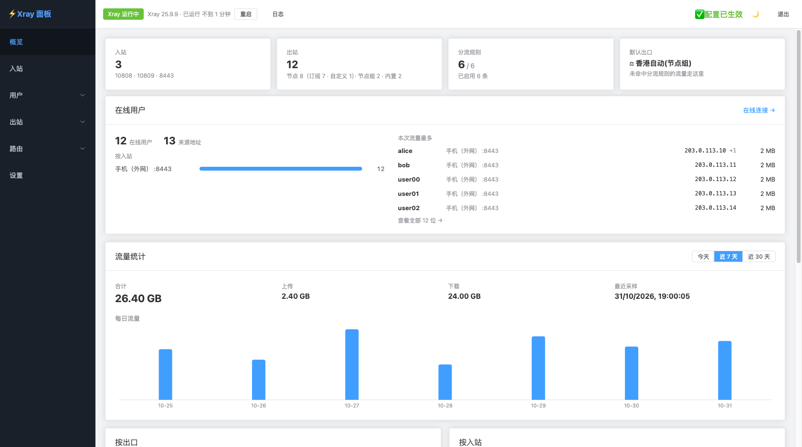
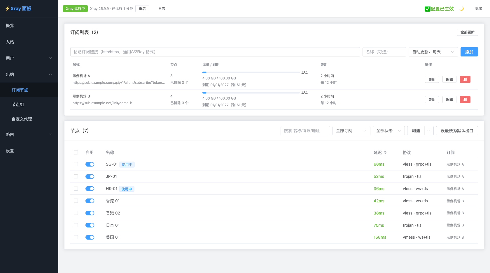
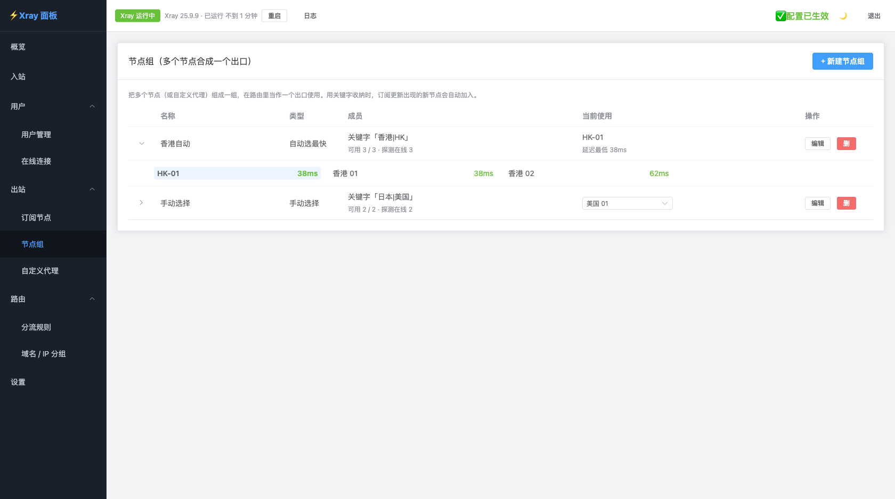
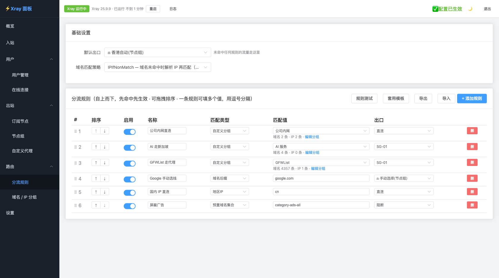
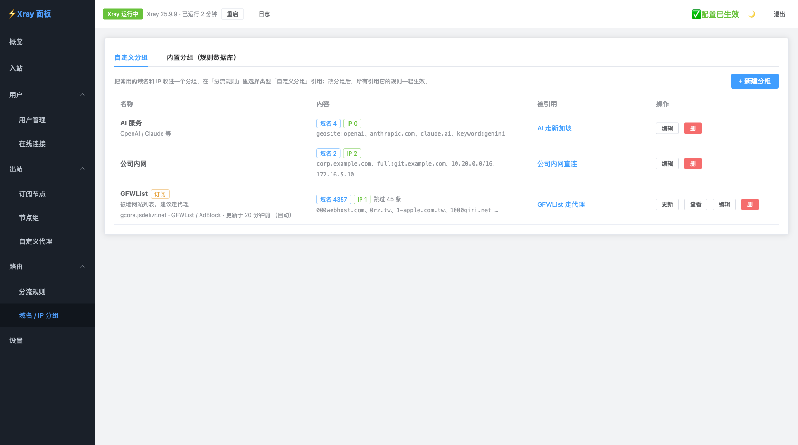
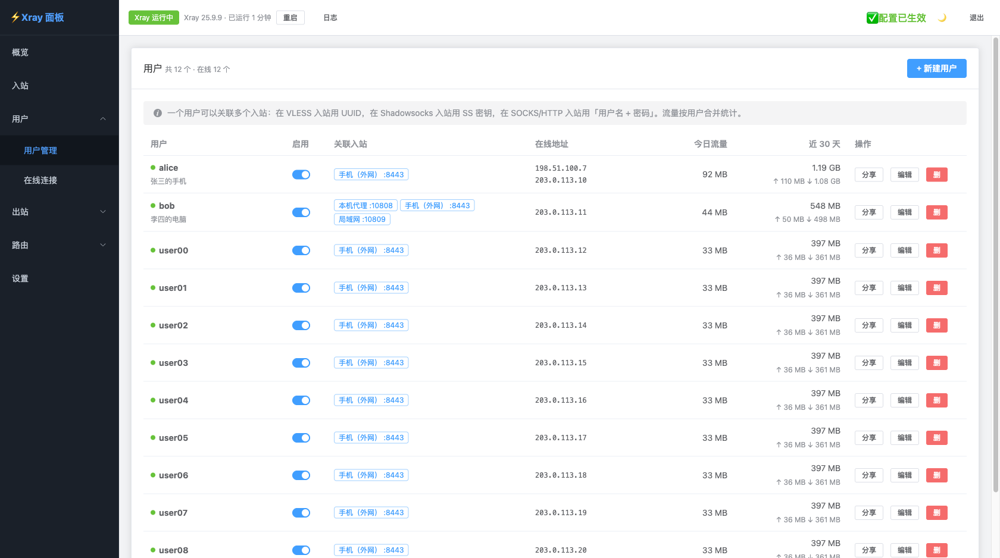
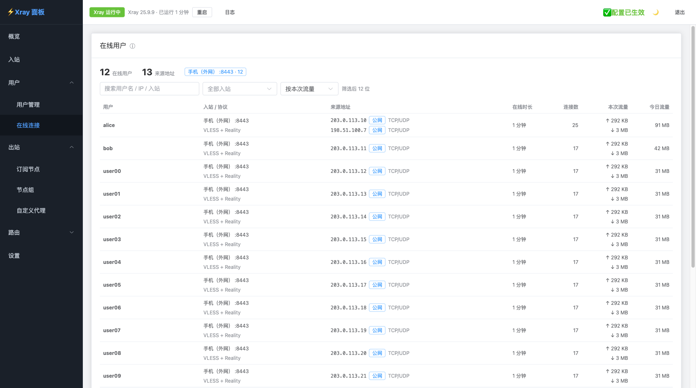
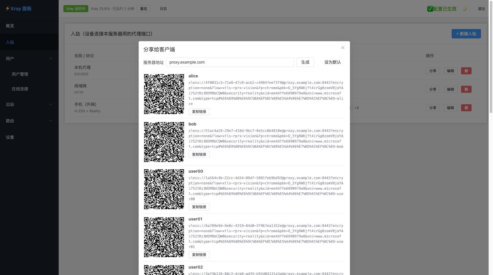
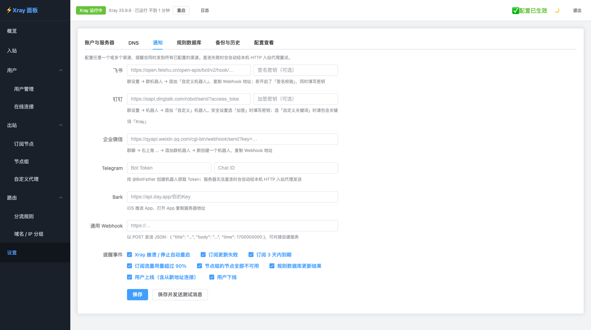
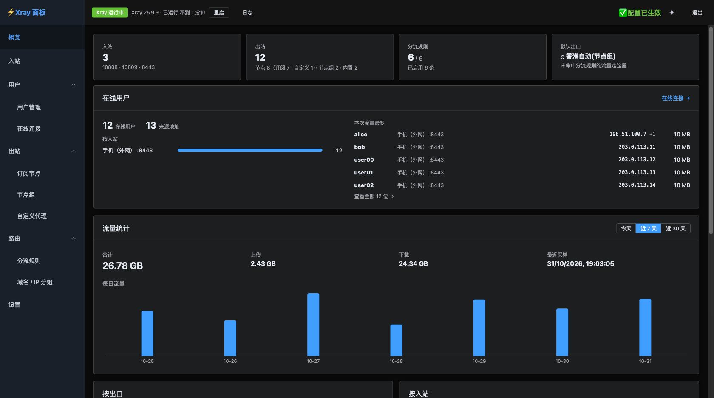

# xray-panel

轻量级 Xray-core 服务器管理面板，Golang 后端 + Vue 前端。单个程序文件（前端已内置），一条命令安装，内存占用 10–20MB。



## 这是什么

[Xray-core](https://github.com/XTLS/Xray-core) 是一个网络代理工具，通常部署在 Linux 服务器上。但 Xray 本身没有图形界面，所有配置都要通过手动编辑 JSON 文件完成——入站端口、出站节点、分流规则等，修改起来繁琐且容易出错。

**xray-panel** 为 Xray-core 提供一个 Web 管理界面，让你在浏览器中就能完成日常操作：

- **订阅与节点**：多个机场订阅，自动解析 vmess / vless / trojan / shadowsocks；定时更新、流量与到期提醒、真实延迟测速
- **入站**：SOCKS / HTTP / VLESS + Reality / Shadowsocks 2022，每个入站可设独立 DNS，一键生成分享链接与二维码
- **用户**：一个用户关联多个入站，按用户统计流量；实时查看在线用户、来源 IP 与协议
- **节点组**：按关键字自动收纳节点，自动选最快或手动切换，订阅更新出现的新节点自动加入
- **分流规则**：按域名、IP 地区、端口、自定义分组指定走向（直连 / 代理 / 阻断），规则可命名、可拖拽排序，内置规则测试
- **域名 / IP 分组**：把常用域名、IP 收进分组；可订阅 GFWList、Clash 规则集等远程列表并自动更新
- **安全应用**：修改后一键校验并重启 Xray，失败自动回滚；保留配置历史，可随时对比、恢复
- **通知**：飞书、钉钉、企业微信、Telegram、Bark、Webhook，覆盖崩溃、订阅失败 / 到期、节点全挂、用户上下线等事件
- **其他**：流量统计、备份导入导出、规则数据库在线更新、暗色主题

## 界面预览

| | |
|:---:|:---:|
|  |  |
| **订阅节点**：多订阅、流量与到期、延迟测速 | **节点组**：自动选最快 / 手动切换，实时显示当前节点 |
|  |  |
| **分流规则**：可命名、拖拽排序、引用自定义分组 | **域名 / IP 分组**：手动维护或订阅 GFWList 等远程列表 |
|  |  |
| **用户管理**：一个用户关联多个入站，按用户统计流量 | **在线连接**：来源 IP、协议、本次与今日流量 |
|  |  |
| **分享给客户端**：每个用户一条链接和二维码 | **通知**：飞书 / 钉钉 / 企业微信等多渠道提醒 |

<p align="center"><br><b>暗色主题</b></p>

> 截图来自演示环境，节点、用户与流量均为示例数据。

## 快速部署

两种方式任选其一，都不需要在服务器上编译。

### 方式一：一键安装（不需要 Docker）

适用于使用 systemd 的 Linux（Debian / Ubuntu / CentOS 等），支持 amd64、arm64、armv7：

```bash
curl -fsSL https://raw.githubusercontent.com/Daydayoneup/xray-webbackend/main/install.sh | sudo bash
```

脚本会下载面板和官方 Xray-core，注册为开机自启的 systemd 服务，最后打印访问地址和初始密码。

- **升级**：再执行一次同样的命令（Xray-core 也会更新到最新版）
- **指定端口 / 版本**：`curl -fsSL ... | sudo PANEL_PORT=8080 VERSION=v1.0.0 bash`
- **访问 GitHub 慢**：`curl -fsSL ... | sudo GH_PROXY=https://ghfast.top/ bash`
- **卸载**：`curl -fsSL ... | sudo bash -s -- uninstall`（保留数据，加 `--purge` 一并删除）
- 配置文件 `/etc/xray-panel/config.env`，数据目录 `/var/lib/xray-panel`

### 方式二：Docker

```bash
docker run -d --name xray-panel --network host --restart always \
  -v /opt/xray-panel:/data/xray ghcr.io/daydayoneup/xray-webbackend:latest

docker logs xray-panel 2>&1 | grep 密码   # 查看初始密码（也保存在 /opt/xray-panel/initial-password.txt）
```

或使用 docker compose（下载 [docker-compose.yml](docker-compose.yml)，需要改端口等配置时把 [.env.example](.env.example) 复制为 `.env` 修改）：

```bash
docker compose up -d                          # 启动
docker compose pull && docker compose up -d   # 升级
```

使用 host 网络，面板中新建的入站端口无需再做端口映射。镜像支持 amd64 和 arm64。

### 登录与密码

浏览器访问 `http://<服务器IP>:2017`。

- **初始密码**：首次启动随机生成，打印在日志中，并保存到数据目录的 `initial-password.txt`；登录后面板会提醒修改，修改后该文件自动删除。也可以首次启动前用 `PANEL_PASSWORD` 指定（只在首次启动时生效，之后修改它不会改变密码）。
- **忘记密码**：在服务器上执行下面的命令重置，不填密码则随机生成。面板运行中也可以执行，30 秒内生效，已登录的设备需要重新登录。

  ```bash
  sudo xray-panel passwd [新密码]                     # 一键安装
  docker exec xray-panel /xray-panel passwd [新密码]  # Docker
  ```

> 面板默认使用 HTTP。公网访问建议用 Nginx / Caddy 反向代理并开启 HTTPS，或用防火墙限制访问来源。

### 从源码构建

```bash
git clone https://github.com/Daydayoneup/xray-webbackend.git && cd xray-webbackend
make build                          # 生成单文件 ./xray-panel（需要 Node 20+、Go 1.25+）
make build GOOS=linux GOARCH=arm64  # 交叉编译
docker build -t xray-panel .        # 或自行构建镜像
```

直接运行 `./xray-panel` 时如果找不到 Xray，会自动从 GitHub 下载官方版本到数据目录的 `bin/`（也可执行 `xray-panel install-xray` 手动下载）。

### 发布新版本

发布由 GitHub Actions 的 Release 流程（`.github/workflows/release.yml`）自动完成，推送 `v*` 标签即可：

```bash
git tag v1.0.0 && git push origin v1.0.0
```

流程依次执行：测试 → 构建单文件二进制（linux amd64 / arm64 / armv7，附 `SHA256SUMS`）→ 推送多架构镜像 → 创建 GitHub Release（附安装说明与更新日志）。一键安装脚本默认下载最新的正式 Release。

| 触发 | 二进制 / Release | 镜像标签 |
|---|---|---|
| 标签 `v1.2.3` | ✅ 正式版 | `1.2.3`、`1.2`、`latest` |
| 标签 `v1.3.0-rc1` | ✅ 预发布 | `1.3.0-rc1`（不更新 `latest`） |
| 推送 main | — | `main`、`sha-xxxxxxx` |
| 手动运行（填写已有标签） | ✅ 覆盖同名附件 | 同该标签 |

## 本地开发

```bash
# 后端（Go 1.25+）。没有嵌入前端时使用工作目录下的 frontend_dist/
cd go-backend
PANEL_PASSWORD=testpw PANEL_DATA_DIR=./data XRAY_BIN=/bin/true go run ./cmd/server/

# 前端（开发热重载，/api 转发到 127.0.0.1:2017）
cd frontend
npm install && npm run dev
```

## 测试

```bash
make test   # 后端 go test + 前端 vitest
```

## 环境变量

可以写成环境变量，也可以写在 `/etc/xray-panel/config.env`（每行 `KEY=VALUE`，`PANEL_CONFIG` 可指定其他路径；环境变量优先）。

| 变量 | 默认值 | 说明 |
|---|---|---|
| `PANEL_PORT` | `2017` | 面板端口 |
| `PANEL_LISTEN` | `0.0.0.0` | 监听地址 |
| `PANEL_DATA_DIR` | `/data/xray` | 数据目录 |
| `PANEL_PASSWORD` | 随机 | 首次启动时的登录密码（之后用面板或 `xray-panel passwd` 修改） |
| `XRAY_BIN` | `/usr/local/bin/xray` | Xray 路径；不存在时依次查找数据目录的 `bin/xray`、PATH，都没有则自动下载 |
| `GH_PROXY` | 空 | 自动下载 Xray 时的 GitHub 加速前缀，如 `https://ghfast.top/` |
| `SOCKS_PORT` | `10808` | 默认 SOCKS 入站端口 |
| `HTTP_PORT` | `10809` | 默认 HTTP 入站端口 |
| `SUBSCRIPTION_ALLOW_INTERNAL` | `false` | 允许拉取内网订阅 |
| `METRICS_PORT` | `10085` | Xray 流量统计端口（仅本机），`0` 关闭流量统计 |
| `TZ` | UTC | 时区，影响通知中的时间与按天流量统计（如 `Asia/Shanghai`） |

## 项目结构

```
├── go-backend/          # Golang 后端 (chi + net/http)
│   ├── cmd/server/      # 程序入口
│   └── internal/        # 业务逻辑 (config/model/store/auth/handler/service)
├── frontend/            # Vue 前端
├── Dockerfile           # 多阶段多架构构建 (xray + node build + go build → scratch)
├── docker-compose.yml   # 使用预构建镜像，配置见 .env.example
├── install.sh           # 一键安装 / 升级 / 卸载（systemd）
└── Makefile             # make build：前端嵌入的单文件二进制
```

## 数据持久化

状态文件和 Xray 生效配置存储在 `$PANEL_DATA_DIR` 下（一键安装为 `/var/lib/xray-panel`，Docker 部署挂载到 `/data/xray`），升级、重启不丢数据。
